  

 

  i build low-level systems and backend software, and i like talking about sciences with people.

 

## ▍ building

  
  

## ▍ stack

## ▍ activity

<picture> <source media="(prefers-color-scheme: dark)" srcset="https://raw.githubusercontent.com/DRAGONTOS/DRAGONTOS/b28d34f014536a291e1180855645622d9ed1222f/snake-dark.svg"/>  </picture>   
artwork generated by <a href="./scripts/gen_assets.py"><code>scripts/gen_assets.py</code></a>

 

artwork generated by <a href="./scripts/gen_assets.py"><code>scripts/gen_assets.py</code></a>

